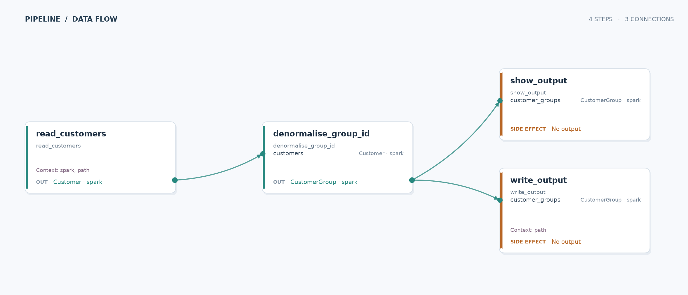

# Customer groups

Enrich customer records with their parent customer's name. This example shows how a pipeline can use a self-join while checking DataFrame schemas.

## Run

After completing the [repository setup](../README.md#setup), run this from the repository root:

```sh
just run-example customer_group
```

The pipeline reads the included Parquet fixture, displays the enriched rows, and writes them to `customer_group_example/__output/output.parquet`.

## Inputs and outputs

| Role | Default path or result |
| --- | --- |
| Input | `customer_group_example/data/customers.parquet` contains customer IDs, names, and optional parent IDs. |
| Output | `customer_group_example/__output/output.parquet` contains customers with `parent_name`. Spark writes this path as a Parquet directory and replaces it on each run. |
| Display | The enriched rows are shown in the terminal. |

## Pipeline



`read_customers` loads the input. `denormalise_group_id` left-joins each customer to its parent, keeping customers without a matching parent. The result goes to the display and writer steps.

## Try a variation

Pass a different input path from the repository root:

```sh
just run-example customer_group --context customers_path=/path/to/customers.parquet
```

Use `--context output_path=/path/to/output.parquet` to change the output path. Add `--skip-side-effects` to run the pipeline without displaying or writing rows.

## What this demonstrates

`Strict` contracts validate the source and enriched DataFrame schemas. The graph sends one transformed result to two side-effect steps, both of which can be skipped.
