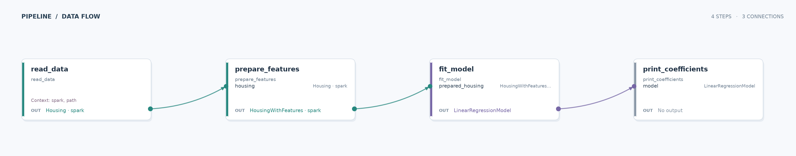

# Housing linear regression

Fit a Spark ML linear regression model to housing data. This example shows a fitted model passing between typed pipeline steps.

## Run

After completing the [repository setup](../README.md#setup), run this from the repository root:

```sh
just run-example housing_linear_regression
```

The pipeline reads the included Parquet fixture and prints the fitted coefficients and intercept.

## Inputs and outputs

| Role | Default path or result |
| --- | --- |
| Input | `housing_linear_regression_example/data/housing.parquet` contains bedroom counts, square footage, and prices. |
| Output | A fitted Spark ML model is passed to the final step; no file is written. |
| Display | The model's coefficients and intercept are printed in the terminal. |

## Pipeline



`read_data` loads the housing records. `prepare_features` assembles bedroom count and square footage into a feature vector, `fit_model` fits a price model, and `print_coefficients` displays its parameters.

## Try a variation

Pass another housing dataset from the repository root:

```sh
just run-example housing_linear_regression --context housing_path=/path/to/housing.parquet
```

Add `--skip-side-effects` to fit the model without printing its parameters.

## What this demonstrates

DataFrame contracts validate feature preparation, and the fitted model is a typed value passed between steps. The printing step is marked as a side effect.
