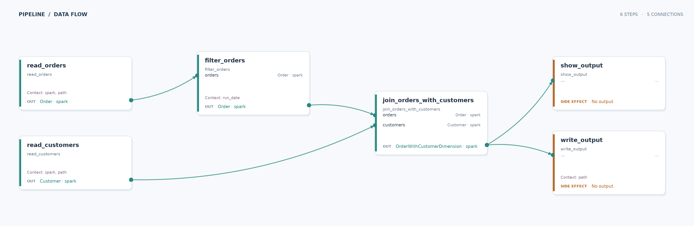

# Orders and customers

Join orders to customer names for one run date. This example shows two input branches and a date supplied through pipeline context.

## Run

After completing the [repository setup](../README.md#setup), run this from the repository root:

```sh
just run-example order_product
```

The pipeline uses the included Parquet fixtures and defaults to `2026-01-01`. It displays the matching orders and writes them to `order_product_example/__output/output.parquet`.

## Inputs and outputs

| Role | Default path or result |
| --- | --- |
| Orders | `order_product_example/data/orders.parquet` contains dated orders. |
| Customers | `order_product_example/data/customers.parquet` contains customer names. |
| Run date | `2026-01-01`; only orders from this date are kept. |
| Output | `order_product_example/__output/output.parquet` contains orders joined to customers. Spark writes this path as a Parquet directory and replaces it on each run. |
| Display | The joined rows are shown in the terminal. |

## Pipeline



The orders branch reads and filters by run date. A second branch reads customers. `join_orders_with_customers` joins the branches by `customer_id`, then sends the result to the display and writer steps.

## Try a variation

Choose another date from the repository root:

```sh
just run-example order_product --context run_date=2026-01-02
```

You can also pass `--context orders_path=/path/to/orders.parquet`, `--context customers_path=/path/to/customers.parquet`, or `--context output_path=/path/to/output.parquet`. Add `--skip-side-effects` to run the pipeline without displaying or writing rows.

## What this demonstrates

The graph joins independent source branches, checks their DataFrame contracts, and injects the run date through context. The two output steps are side effects that can be skipped.

The schemas use [JoineryModel](https://ccharlesgb.github.io/data-joinery/learn/schemas/joinery_model/) with `Column[T]` fields. Transforms refer to columns through model attributes such as `Order.order_timestamp` and `Order.customer_id`. Test fixtures construct model rows with keyword arguments.
