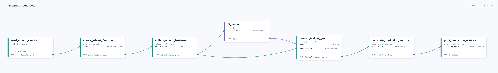

# Spark to scikit-learn

Aggregate advert events in Spark, then train and score a scikit-learn model with Polars data. This example shows DataFrames and a fitted model moving between typed steps.

## Run

After completing the [repository setup](../README.md#setup), run this from the repository root:

```sh
just run-example sklearn_spark
```

The pipeline reads the included Parquet fixture and prints prediction metrics for the training data.

## Inputs and outputs

| Role | Default path or result |
| --- | --- |
| Input | `sklearn_spark_example/data/advert_events.parquet` contains timestamped search and view events. |
| Output | Predictions and metrics are passed between steps; no file is written. |
| Display | Mean absolute error, mean squared error, and R² are printed in the terminal. |

## Pipeline



Spark counts searches and views by date and advert. The small aggregated feature set is converted to Polars; scikit-learn fits a linear regression model and predicts those same rows. A final step calculates and prints the metrics.

## Try a variation

Pass another event dataset from the repository root:

```sh
just run-example sklearn_spark --context advert_events_path=/path/to/advert_events.parquet
```

Add `--skip-side-effects` to calculate the metrics without printing them.

## What this demonstrates

Contracts cover both Spark and Polars DataFrames, while typed Python values carry the model and metrics through the graph. These are training-set metrics, not held-out performance estimates.
