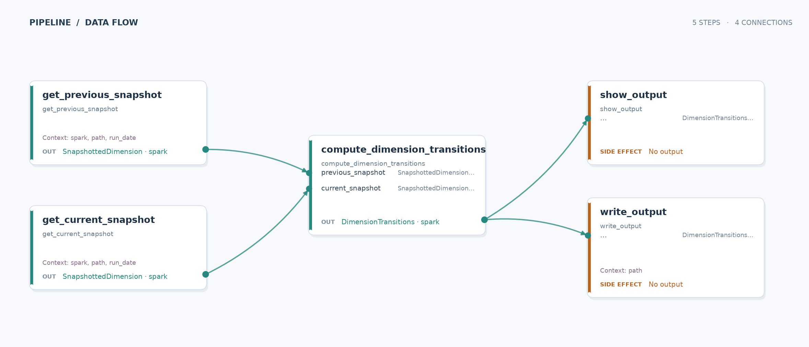

# Snapshot transitions

Compare an entity snapshot with the previous day's snapshot. This example shows two branches reading the same source and connecting to distinct transform parameters.

## Run

After completing the [repository setup](../README.md#setup), run this from the repository root:

```sh
just run-example snapshot_diff
```

The pipeline defaults to `2026-01-01`, so it compares that date with `2025-12-31`. It displays the paired rows and writes them to `snapshot_diff_example/__output/output.parquet`.

## Inputs and outputs

| Role | Default path or result |
| --- | --- |
| Input | `snapshot_diff_example/data/snapshotted_dimension.parquet` contains dated entity attributes and update timestamps. |
| Run date | `2026-01-01`; the other branch reads the preceding day. |
| Output | `snapshot_diff_example/__output/output.parquet` contains current values beside prior values. Spark writes this path as a Parquet directory and replaces it on each run. |
| Display | The paired rows are shown in the terminal. |

## Pipeline



`get_previous_snapshot` and `get_current_snapshot` select different dates from the same source. `compute_dimension_transitions` pairs their rows by entity. Entities without a prior row are omitted, while unchanged pairs remain in the result. The paired rows go to the display and writer steps.

## Try a variation

Compare a different pair of consecutive dates from the repository root:

```sh
just run-example snapshot_diff --context run_date=2026-01-02
```

You can also pass `--context snapshotted_dimension_path=/path/to/snapshots.parquet` or `--context output_path=/path/to/output.parquet`. Add `--skip-side-effects` to run the pipeline without displaying or writing rows.

## What this demonstrates

Named connections route two DataFrames with the same schema into different transform parameters. Context supplies the run date, and side-effect steps handle output.
