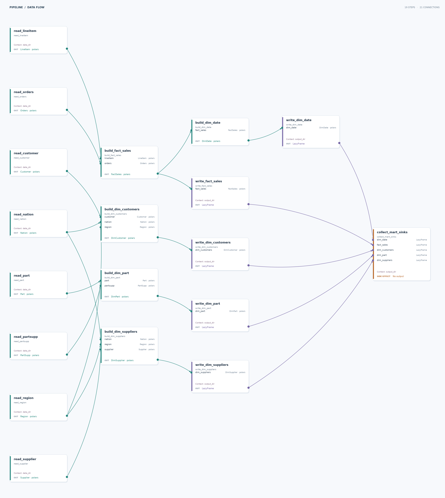

# TPC-H analytical mart (Polars)

Build a five-table analytical mart from eight TPC-H Parquet sources. This example keeps its source and intermediate tables as Polars `LazyFrame` queries and writes the same mart as the [Spark example](../tpch_spark_example/README.md).

## Run

After completing the [repository setup](../README.md#setup), generate the shared source data and run the pipeline from the repository root:

```sh
just generate-datasets
just run-example tpch_polars
```

The pipeline writes five Parquet files to `tpch_polars_example/__output/`. The generated source data needs substantial disk space and memory.

## Inputs and outputs

| Role | Default path or result |
| --- | --- |
| Input | `datasets/tpch/` contains the eight generated TPC-H Parquet tables shared with the Spark example. |
| Output directory | `tpch_polars_example/__output/`; each run replaces the five output files. |

| Output file | Grain |
| --- | --- |
| `fact_sales.parquet` | One row per order line. |
| `dim_customers.parquet` | One row per customer. |
| `dim_suppliers.parquet` | One row per supplier. |
| `dim_part.parquet` | One row per part and supplier. |
| `dim_date.parquet` | One row per day across the fact date range. |

## Pipeline



Reader steps project and cast source columns. Model steps join the sources into a sales fact table and four dimensions; the date dimension derives from the lazy fact table. Writer steps prepare lazy Parquet sinks, and one side-effect step runs all five with `pl.collect_all`.

## Try a variation

Use other source and output directories from the repository root:

```sh
just run-example tpch_polars \
  --context data_dir=/path/to/tpch/data \
  --context output_dir=/path/to/mart
```

Add `--skip-side-effects` to build and validate the intermediate lazy plans without writing mart files. To draw the graph, run `uv run --package tpch-polars data-joinery visualize tpch_polars.main --output pipeline.svg`.

## What this demonstrates

Data Joinery validates `LazyFrame` schemas without collecting the full data. Source value checks run as streaming queries and collect only the first invalid row if one exists; the final side effect streams the five sink plans to Parquet in one `pl.collect_all` call. This example requires a Data Joinery build with Polars `LazyFrame` contract support.
