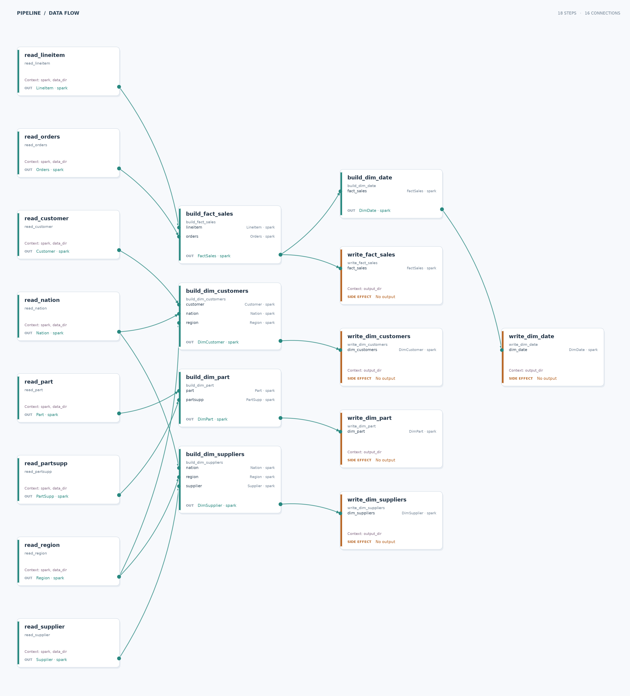

# TPC-H analytical mart (Spark)

Build a five-table analytical mart from eight TPC-H Parquet sources. This example uses Spark to clean and validate the sources, join them into a star schema, and write the result.

## Run

After completing the [repository setup](../README.md#setup), generate the shared source data and run the pipeline from the repository root:

```sh
just generate-datasets
just run-example tpch_spark
```

The pipeline writes five Parquet directories to `tpch_spark_example/__output/`. The data and joins need substantial disk space and memory; the example configures ten local Spark tasks and a 4 GiB driver heap.

## Inputs and outputs

| Role | Default path or result |
| --- | --- |
| Input | `datasets/tpch/` contains the eight generated TPC-H Parquet tables shared with the Polars example. |
| Output directory | `tpch_spark_example/__output/`; each run replaces the five output directories. |

| Output directory | Grain | Key details |
| --- | --- | --- |
| `fact_sales` | One row per order line | `(order_key, line_number)`; customer, supplier, and part keys; dates; revenue, total cost, and late flag. |
| `dim_customers` | One row per customer | Customer attributes with nation and region. |
| `dim_suppliers` | One row per supplier | Supplier attributes with nation and region. |
| `dim_part` | One row per part and supplier | The `(part_key, supplier_key)` key retains `partsupp` attributes without multiplying sales rows. |
| `dim_date` | One row per calendar day | Covers the fact date range, with year, quarter, month name, and weekend flag. |

## Pipeline



Reader steps project and cast source columns and check non-null values and one-character flags. Model steps build the sales fact table and four dimensions; the date dimension derives from the fact table. Writer steps overwrite the output directories. The fact table is cached on Spark executor disk so its writer and `dim_date` can share the same order-line join.

The fact measures use `revenue = extended_price × (1 - discount)` and `total_cost = revenue × (1 + tax)`. `is_late_shipment` is true when receipt date is after commit date. Money inputs use `DECIMAL(15,2)`; calculated measures use `DECIMAL(20,4)` and `DECIMAL(22,6)`. `order_total_price` is an order attribute repeated on each line, so summing it across fact rows would double-count orders.

## Try a variation

Use other source and output directories from the repository root:

```sh
just run-example tpch_spark \
  --context data_dir=/path/to/tpch/data \
  --context output_dir=/path/to/mart
```

Add `--skip-side-effects` to run the graph without writing mart tables. To draw the graph, run `uv run --package tpch-spark data-joinery visualize tpch_spark.main --output pipeline.svg`.

## What this demonstrates

Data Joinery checks DataFrame contracts as Spark reads and transforms source tables. The reader steps clean the sources directly, and side-effect steps write the finished mart. The [Polars example](../tpch_polars_example/README.md) builds the same tables with lazy queries.
