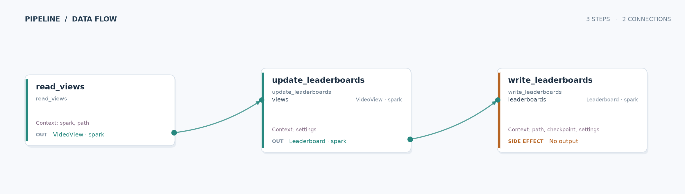

# Live video leaderboards

Build a small streaming service's “Trending in Music” and “Trending in Gaming”
leaderboards. Each view contributes one vote for a video in its category. A
Data Joinery pipeline reads an append-only Delta table, maintains exact counts
in Spark Structured Streaming, and updates another Delta table after each
micro-batch.

## Run

After the [repository setup](../README.md#setup), run from the repository root:

```sh
just run-example video_topk
```

This initializes six sample views if the default source does not exist, processes
available data, writes the leaderboards, and exits. Repeating the command resumes
the same checkpoint. It does not append the sample views again.

To watch a leader change, an out-of-order view arrive, and windows finalize:

```sh
uv run --package video-topk python -m video_topk.demo
```

The demo prints each stage and resumes the same streaming checkpoint between
batches. It uses a temporary directory that is removed when it finishes. The
regular CLI command keeps its tables under `video_topk_example/__output/`.

Python 3.14+, Java 17+, Spark 4.1.0 and Delta Lake 4.1.0 are used. The first run
downloads Delta's JVM jars from Maven; Python dependencies are installed by
`just install`.

## Inputs and outputs

| Role | Default path |
| --- | --- |
| Source Delta table | `video_topk_example/__output/views` |
| Leaderboard Delta table | `video_topk_example/__output/leaderboards` |
| Streaming checkpoint | `video_topk_example/__output/checkpoint` |

The source contract is deliberately small:

| Column | Type | Meaning |
| --- | --- | --- |
| `event_time` | timestamp | When the view happened, interpreted in UTC. |
| `category` | string | For example, `music` or `gaming`. |
| `video_id` | string | The video receiving one view. |

Extra source columns are projected away. Null timestamps, null or empty
categories, and null or empty video IDs are filtered out. Each appended row is
one view: duplicate source events count again. This example assumes an append-only
event table, with stable category assignments, and does not process source updates,
deletes, or event-ID deduplication.

The output has one row per `(window_start, window_end, category)`:

| Column | Type | Meaning |
| --- | --- | --- |
| `window_start`, `window_end` | timestamp | UTC window boundaries. |
| `category` | string | Leaderboard category. |
| `top_videos` | array of structs | Ordered `{rank: bigint, video_id: string, view_count: bigint}` entries, up to K. |
| `is_final` | boolean | True once the watermark closes the window. |

For example, two music views for `acoustic-session` and one for `synth-live`
produce `[{1, acoustic-session, 2}, {2, synth-live, 1}]`. Three more views for
`synth-live` replace that list with
`[{1, synth-live, 4}, {2, acoustic-session, 2}]`.

Read the output using a Delta-enabled Spark session, or flatten it for a UI:

```python
from pyspark.sql import functions as F
from video_topk.context import create_spark

spark = create_spark()
try:
    boards = spark.read.format("delta").load("video_topk_example/__output/leaderboards")
    boards.select(
        "window_start",
        "window_end",
        "category",
        "is_final",
        F.explode("top_videos").alias("video"),
    ).select(
        "window_start",
        "window_end",
        "category",
        "is_final",
        "video.*",
    ).orderBy("window_start", "category", "rank").show(truncate=False)
finally:
    spark.stop()
```

## Pipeline



`read_views` creates a streaming Delta DataFrame. `update_leaderboards` applies
an event-time watermark, assigns tumbling windows, and calls Spark 4.1's
Row-based `transformWithState`. `write_leaderboards` starts the query and uses a
contracted `merge_leaderboards` side effect inside `foreachBatch` to replace
changed snapshots in Delta.

The processor groups by window and category. Its checkpointed `MapState` keeps
every video's count, including videos outside the current TOPK. Each micro-batch
emits a complete leaderboard for each changed group, ordered by descending count
and then ascending video ID. Ties never expand the result beyond K. Replacing the
array removes displaced videos; a retry of the same snapshot has the same result.
Use one query/checkpoint as the owner of a target table.

The checkpoint also contains a `top_k_cache` value for each group, holding K and
at most K video counts. Accepted views update the full count and compare the
changed video against the cached leaders. Counts only increase, so other videos
outside the cache cannot become leaders without receiving another view. The cache
is written once per changed group per micro-batch; snapshots sort only its K
entries instead of scanning every video's count. Comparing an outside candidate
with the cached leaders takes O(K) work in Python and uses O(K) local memory.
The full count map still grows with distinct videos, and updates still read and
write a count for each accepted view.

Existing checkpoints without a cache are supported: the first accepted input or
finalization for a group rebuilds its cache from the full count map once. Changing
K also causes a rebuild for each group when it next receives input or finalizes.

Each group registers an event-time timer at its window end. When the watermark
passes it, the processor emits `is_final=true` and clears the group's counts and
cache. Finalized output rows remain in Delta as history. Active state grows with distinct
videos in open windows, rather than only K; keeping all counts is necessary for
exact rankings. A very popular category/window is one processing group, so this
example is intended to explain the behavior rather than shard hot categories.

Defaults are K=10, 5-minute tumbling windows, and a 2-minute watermark delay.
Windows are `[start, end)`, aligned to UTC: `12:05:00` belongs to the
`12:05–12:10` window. Views at or before the current watermark are discarded.
The watermark follows the maximum observed event time across the stream, so
activity in one category can close another category's windows. Future-dated
events should be checked upstream in a real application.

Finalization depends on newer events arriving. An idle stream, or reaching the end
of an AvailableNow run, does not advance event time and close the last windows.
An open window can remain in the output after its wall-clock end until the
watermark passes it. The initial Delta snapshot is read with `withEventTimeOrder`
to avoid dropping old files solely because their file modification order differs
from event-time order.

## Try a variation

Keep the query running with micro-batches every five seconds:

```sh
just run-example video_topk --context available_now=false --context 'trigger_interval=5 seconds'
```

Append new view rows to the source table from a second process. Stop with Ctrl-C;
the writer stops its active query. This is a processing-time micro-batch trigger,
with updated results while windows remain open.

Use your own path-based Delta tables and a dedicated checkpoint:

```sh
just run-example video_topk \
  --context input_path=/tmp/video-views \
  --context output_path=/tmp/video-leaderboards \
  --context checkpoint_path=/tmp/video-topk-checkpoint \
  --context available_now=false
```

The supplied input table must already exist. To create a small one or append views
from another process, use `video_topk.demo.append_views(spark, path, rows)` with
`VideoView` records and a session from `create_spark()`.

Override `k`, `window_minutes`, or `lateness_minutes` through `--context`. Use fresh
output and checkpoint paths when changing these semantics. Keep the same source,
output, configuration, and checkpoint together on ordinary restarts. Starting a
new checkpoint against an existing target does not remove old output groups that
the new run never emits.

`--skip-side-effects` builds and validates the streaming plan without starting the
query or writing leaderboards. The default context may still initialize its demo
source and starts a Spark session; it is not a filesystem dry run. Visualizing the
graph creates no session:

```sh
uv run --package video-topk data-joinery visualize video_topk.main --output /tmp/video-topk.svg
```

## Tests

```sh
uv run --all-packages pytest video_topk_example/tests
```

The integration test uses real Delta input/output, a checkpoint reused across
query restarts, deterministic fixtures, and complete DataFrame comparisons. It
covers category isolation, tie-breaking, TOPK displacement, a returning candidate,
late data, tumbling boundaries, finalization, state eviction, sink retries, and
updates through a persistent processing-time trigger.

Processor unit tests compare incremental rankings against full-count rankings
across batches, check cache recovery and K changes, and verify that cached updates
and finalization do not scan the full count map.

The implementation follows Spark's
[stateful processing API](https://spark.apache.org/docs/4.1.0/streaming/structured-streaming-transform-with-state.html)
and Delta's
[streaming MERGE pattern](https://docs.delta.io/delta-update/#upsert-from-streaming-queries-using-foreachbatch).
